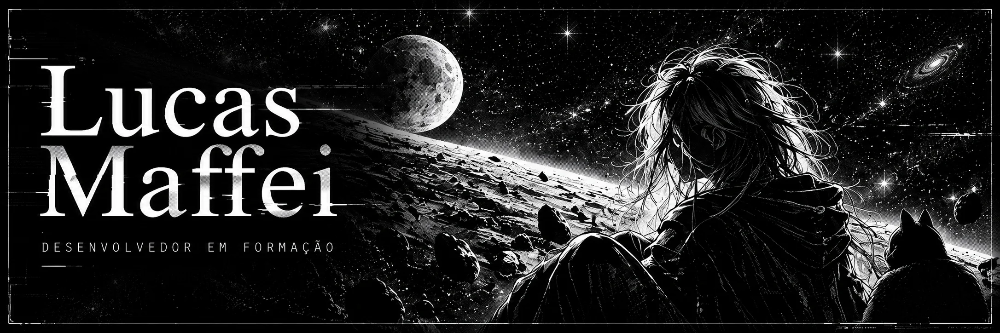

## `// SOBRE MIM`

Olá! Sou **Lucas Maffei**, estudante de **Sistemas de Informação na UNISUL** e desenvolvedor em formação.

Atualmente estudo **Java** e tenho interesse em desenvolvimento de software, Linux e jogos. Busco aprender continuamente e transformar esse aprendizado em prática.

Fora dos estudos, gosto de anime, osu! e correr ao ar livre.

---

## `// ATUALMENTE`

- **Estudos** — Java e fundamentos de desenvolvimento de software.
- **Interesses** — Linux, jogos e novas possibilidades com tecnologia.
- **Objetivo** — Consolidar minha base em programação para desenvolver meus próprios projetos.

---

### Some technologies I use

### GitHub Stats

 
