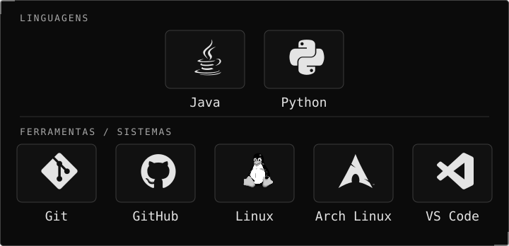
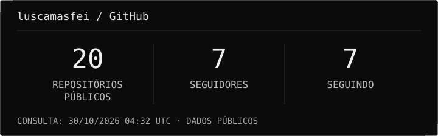
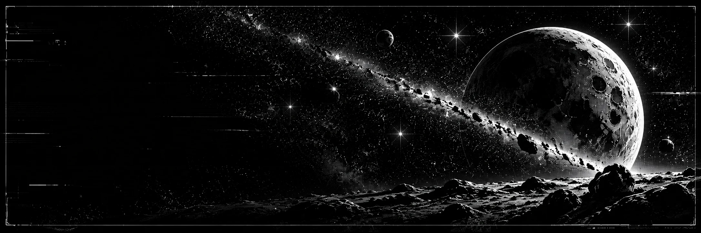

## `// SOBRE MIM`

Olá! Sou **Lucas Maffei**, estudante de **Sistemas de Informação na UNISUL** e desenvolvedor em formação.

Atualmente estudo **Java** e tenho interesse em desenvolvimento de software, Linux e jogos. Busco aprender continuamente e transformar esse aprendizado em prática.

Fora dos estudos, gosto de anime, osu! e correr ao ar livre.

## `// ATUALMENTE`

- **Estudos** — Java e fundamentos de desenvolvimento de software.
- **Interesses** — Linux, jogos e novas possibilidades com tecnologia.
- **Objetivo** — Consolidar minha base em programação para desenvolver meus próprios projetos.

## `// TECNOLOGIAS`

**Java é meu foco atual de estudos.** Python também faz parte das tecnologias com que tenho contato; Git, GitHub, Linux, Arch Linux e VS Code compõem meu conjunto de ferramentas e interesses. Esta seleção não representa domínio avançado.

## `// PROJETOS EM DESTAQUE`

### [Sistema de contas a pagar](https://github.com/luscamasfei/A3_Algoritmo_e_programacao)

> **Java · Projeto acadêmico em equipe**
>
> Trabalho A3 da disciplina de Algoritmos e Programação: um sistema de contas a pagar desenvolvido em grupo, com minha participação.

### [Liriane Wagner](https://github.com/luscamasfei/lirianewagner)

> **JavaScript · Portfólio digital**
>
> Portfólio digital da arquiteta Liriane Wagner, de Passo Fundo (RS).

## `// ESTATÍSTICAS GITHUB`

> Pequenos progressos constantes resultam em grandes mudanças.

